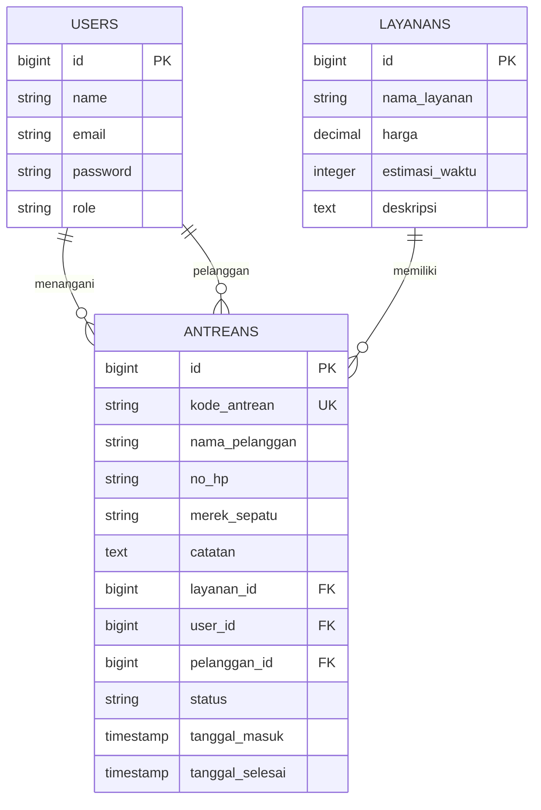

# Entity Relationship Diagram (ERD)

Diagram berikut menggambarkan hubungan antara tabel users, layanans, dan antreans pada aplikasi Patina Archive.

## Kamus Data

### 1. Tabel: `USERS`
Menyimpan data akun pengguna sistem (admin, petugas, dan pelanggan).

| Nama Kolom | Tipe Data | Kunci | Keterangan |
|---|---|---|---|
| `id` | `bigint` | PK | Identitas unik pengguna (*Auto Increment*) |
| `name` | `string` | - | Nama lengkap pengguna |
| `email` | `string` | - | Alamat email pengguna |
| `password` | `string` | - | Kata sandi terenkripsi (*hash*) |
| `role` | `string` | - | Peran pengguna dalam sistem (`admin`, `petugas`, `pelanggan`) |

---

### 2. Tabel: `LAYANANS`
Menyimpan informasi daftar layanan pencucian/perawatan sepatu.

| Nama Kolom | Tipe Data | Kunci | Keterangan |
|---|---|---|---|
| `id` | `bigint` | PK | Identitas unik layanan (*Auto Increment*) |
| `nama_layanan` | `string` | - | Nama jenis layanan (*Deep Clean*, *Fast Clean*, *Repaint*, dll) |
| `harga` | `decimal` | - | Tarif harga layanan |
| `estimasi_waktu` | `integer` | - | Perkiraan lama pengerjaan |
| `deskripsi` | `text` | - | Penjelasan detail cakupan layanan |

---

### 3. Tabel: `ANTREANS`
Menyimpan data transaksi antrean pengerjaan sepatu.

| Nama Kolom | Tipe Data | Kunci | Keterangan |
|---|---|---|---|
| `id` | `bigint` | PK | Identitas unik antrean (*Auto Increment*) |
| `kode_antrean` | `string` | UK | Kode transaksi antrean unik (contoh: `ANT-001`) |
| `nama_pelanggan` | `string` | - | Nama pelanggan pemilik sepatu |
| `no_hp` | `string` | - | Nomor kontak/WhatsApp pelanggan |
| `merek_sepatu` | `string` | - | Merek atau tipe sepatu yang dicuci |
| `catatan` | `text` | - | Catatan khusus kondisi sepatu |
| `layanan_id` | `bigint` | FK | Referensi ke `LAYANANS(id)` |
| `user_id` | `bigint` | FK | Referensi ke `USERS(id)` untuk petugas penanggung jawab |
| `pelanggan_id` | `bigint` | FK | Referensi ke `USERS(id)` untuk akun pelanggan terdaftar |
| `status` | `string` | - | Status pengerjaan (`menunggu`, `diproses`, `selesai`, `diambil`) |
| `tanggal_masuk` | `timestamp` | - | Waktu antrean dibuat / sepatu diterima |
| `tanggal_selesai` | `timestamp` | - | Waktu pengerjaan selesai |

---

### Relasi Tabel (Foreign Keys)
* `ANTREANS.layanan_id` -> `LAYANANS.id`
* `ANTREANS.user_id` -> `USERS.id` (Petugas)
* `ANTREANS.pelanggan_id` -> `USERS.id` (Pelanggan)

## Keterangan Relasi

1. Satu layanan dapat digunakan oleh banyak antrean.
2. Satu user dapat menangani banyak antrean sebagai operator.
3. Satu user dapat memiliki banyak antrean sebagai pelanggan apabila fitur akun pelanggan digunakan.
4. Pelanggan tanpa akun dapat mendaftar tanpa mengisi `pelanggan_id`.
